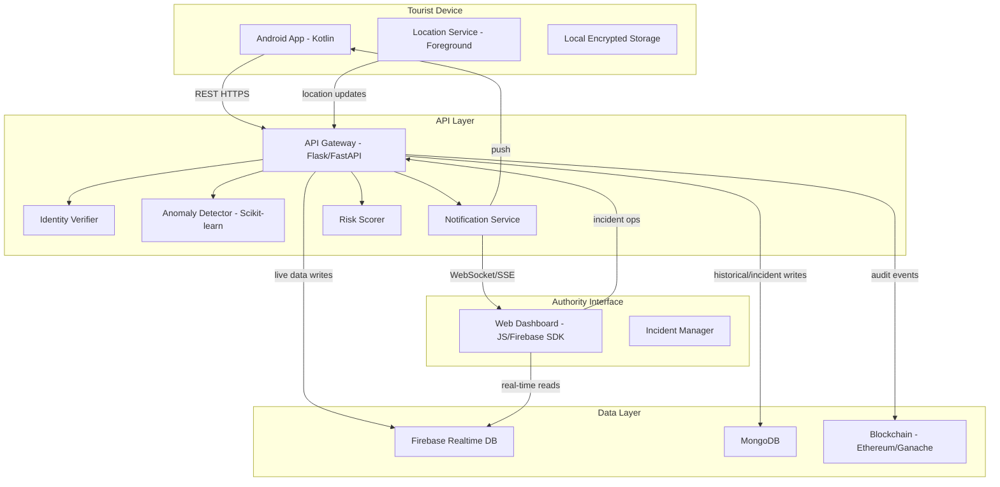
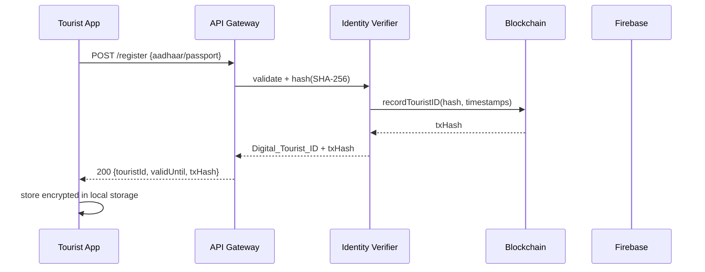

# Design Document

## Smart Tourist Safety Monitoring & Incident Response System — Maharashtra

---

## Overview

The system is a multi-tier safety platform that protects tourists across Maharashtra's diverse geography. It combines a blockchain-anchored identity layer, a real-time mobile tracking app, an AI anomaly detection engine, and a centralised authority dashboard into a single cohesive platform.

The architecture follows a hub-and-spoke model: the Python backend (Flask/FastAPI) acts as the central API Gateway mediating all communication between the Android app, Firebase Realtime Database, the Scikit-learn anomaly detection service, and the Ethereum/Ganache blockchain. The web dashboard consumes Firebase directly via the Web SDK for low-latency real-time updates, while write operations that require audit trails go through the API Gateway.

**Key design decisions:**

- Firebase Realtime Database is used for live location and SOS events (sub-second latency), while MongoDB stores historical records and incident data (richer querying).
- Blockchain writes are asynchronous — the system does not block user-facing operations waiting for on-chain confirmation; a transaction hash is returned and stored once the block is mined.
- AES-256 encryption is applied at the application layer before data reaches Firebase, ensuring PII is never stored in plaintext even in the database.
- The Anomaly Detector runs as a separate Python process/worker, consuming location events from a queue, to avoid blocking the API Gateway.

---

## Architecture





---

## Components and Interfaces

### 1. Android Mobile App (Kotlin)

**Responsibilities:** Registration, session management, GPS tracking, geo-fence alerts, SOS, safety score display, offline buffering.

**Key classes:**
- `RegistrationActivity` — collects Aadhaar/passport, calls `/register`, stores encrypted `Digital_Tourist_ID`
- `MainActivity` — home screen showing ID, safety score, SOS button
- `LocationTrackingService` — foreground service, FusedLocationProviderClient, 10s normal / 3s SOS intervals
- `GeofenceManager` — client-side zone check using Haversine distance; syncs zone list from API on startup
- `OfflineBuffer` — Room database queue for location updates and SOS events when offline
- `TouristPreferences` — EncryptedSharedPreferences wrapper for local secure storage

**REST calls (all over TLS):**

| Method | Endpoint | Purpose |
|--------|----------|---------|
| POST | `/api/v1/register` | Submit identity, receive Digital_Tourist_ID |
| POST | `/api/v1/location` | Push GPS update |
| POST | `/api/v1/sos` | Trigger SOS event |
| GET | `/api/v1/zones` | Fetch current geo-fence zone list |
| GET | `/api/v1/score/{touristId}` | Get current safety score |

### 2. Python API Gateway (Flask/FastAPI)

**Responsibilities:** Request routing, authentication (JWT), input validation, orchestration of backend services.

**Endpoints:**

| Method | Path | Handler |
|--------|------|---------|
| POST | `/api/v1/register` | `identity_controller.register` |
| POST | `/api/v1/location` | `location_controller.update` |
| POST | `/api/v1/sos` | `sos_controller.trigger` |
| GET | `/api/v1/zones` | `zone_controller.list` |
| GET | `/api/v1/score/{id}` | `score_controller.get` |
| POST | `/api/v1/incidents` | `incident_controller.create` |
| PATCH | `/api/v1/incidents/{id}` | `incident_controller.update_status` |
| GET | `/api/v1/blockchain/verify/{txHash}` | `blockchain_controller.verify` |

**Middleware stack:** TLS termination → Rate limiter → JWT auth → RBAC check → Request handler

### 3. Identity Verifier

**Responsibilities:** Format-validate Aadhaar (12-digit) and passport (alphanumeric), SHA-256 hash, issue `Digital_Tourist_ID` (UUID v4), write to blockchain, detect duplicates.

**Duplicate detection:** Before issuing a new ID, query MongoDB for an active record with the same SHA-256 hash where `visitEndTimestamp > now()`.

### 4. Anomaly Detector (Scikit-learn)

**Responsibilities:** Consume location history from Firebase/MongoDB, apply movement analysis rules, generate tiered alerts.

**Detection rules (from requirements):**

| Trigger | Threshold | Alert Level |
|---------|-----------|-------------|
| No movement | < 10m in 10 min, non-accommodation zone | LOW |
| Abnormal speed | > 30 m/s | MEDIUM |
| GPS loss in HIGH/RESTRICTED zone | > 5 min | HIGH |
| Route deviation | > 500m from planned route | MEDIUM |
| No response to safety check | 5 min timeout | Escalate +1 level |

**Model:** Isolation Forest (Scikit-learn) trained on historical movement patterns for anomaly scoring; rule-based thresholds applied on top for deterministic alert generation.

**Processing:** Runs as an async worker (Celery or asyncio task queue), processes location events in near-real-time.

### 5. Risk Scorer

**Responsibilities:** Compute a 0–100 safety score for a tourist's current location.

**Scoring formula:**

```
base_score = zone_score(zone_classification)   # LOW=90, MEDIUM=65, HIGH=35, RESTRICTED=10
incident_penalty = min(30, incident_density_last_30_days * 3)
time_penalty = night_penalty(current_hour)     # 0 (day) or 10 (22:00–05:00)
safety_score = max(0, base_score - incident_penalty - time_penalty)
```

**Labels:** SAFE (70–100), CAUTION (40–69), DANGER (0–39)

### 6. Geo-Fence Engine

**Responsibilities:** Maintain zone registry, detect zone entry/exit, trigger alerts with cooldown, log RESTRICTED entries to blockchain.

**Maharashtra zone registry (initial seed):**

| Zone Name | Type | Risk Level |
|-----------|------|------------|
| Mumbai Urban Core | Urban | MEDIUM |
| Dharavi | Urban | HIGH |
| Konkan Coastal Belt | Coastal | MEDIUM |
| Ratnagiri Coastal | Coastal | HIGH |
| Mahabaleshwar | Hill Station | LOW |
| Lonavala | Hill Station | LOW |
| Tadoba Tiger Reserve | Forest | RESTRICTED |
| Melghat Tiger Reserve | Forest | RESTRICTED |
| Ajanta Caves | Heritage | LOW |
| Ellora Caves | Heritage | LOW |
| Nagpur Urban | Urban | MEDIUM |
| Pune Urban Core | Urban | MEDIUM |

**Zone entry detection:** Haversine distance check on every location update. Alert cooldown: 5 minutes per tourist per zone (stored in Redis or in-memory with TTL).

### 7. SOS Handler

**Responsibilities:** Create SOS Event, write to blockchain, notify dashboard, increase location frequency, send confirmation to tourist.

**SOS Event lifecycle:** `ACTIVE` → `ACKNOWLEDGED` → `RESOLVED`

### 8. Blockchain Ledger (Solidity / Ethereum / Ganache)

**Responsibilities:** Immutable audit trail for critical events.

**Smart contract — `TouristSafety.sol`:**

```solidity
// Key functions
function registerTourist(bytes32 idHash, uint256 visitStart, uint256 visitEnd) external returns (uint256 tokenId)
function expireTourist(uint256 tokenId) external
function recordSosEvent(uint256 tokenId, int256 lat, int256 lng, uint256 timestamp) external returns (bytes32 eventId)
function resolveSosEvent(bytes32 eventId, address officerId) external
function recordZoneEntry(uint256 tokenId, string calldata zoneName, uint256 timestamp) external
function resolveIncident(bytes32 incidentId, address officerId, uint256 timestamp) external
```

**Events emitted:** `TouristRegistered`, `TouristExpired`, `SosCreated`, `SosResolved`, `RestrictedZoneEntered`, `IncidentResolved`

### 9. Firebase Realtime Database

**Structure:**

```
/LiveLocation/{touristId}
  latitude, longitude, timestamp, status, safetyScore

/LocationHistory/{touristId}/{pushId}
  latitude, longitude, timestamp

/SOS/{touristId}
  latitude, longitude, timestamp, status, txHash

/Alerts/{pushId}
  touristId, type, riskLevel, latitude, longitude, timestamp

/Zones/{zoneId}
  name, type, riskLevel, centerLat, centerLng, radiusMeters, active
```

**Security rules:** Firebase rules enforce that tourists can only write to their own `LiveLocation` and `SOS` paths; dashboard reads require auth token with `AUTHORITY` or `ADMIN` claim.

### 10. MongoDB Collections

```
tourists: { touristId, idHash, visitStart, visitEnd, status, txHash, region }
incidents: { incidentId, linkedSosId, touristId, status, createdAt, resolvedAt, officerId, txHash }
location_history: { touristId, lat, lng, timestamp }  // TTL index: 90 days after visitEnd
zones: { zoneId, name, type, riskLevel, polygon, active, updatedAt }
audit_log: { userId, action, resource, timestamp, allowed }
```

### 11. Web Dashboard (HTML/CSS/JS + Firebase Web SDK)

**Responsibilities:** Real-time tourist map, alert panels, incident management, tourist detail view, blockchain verification, RBAC-gated views.

**Key views:**
- Map view: Leaflet.js map centred on Maharashtra with tourist markers colour-coded by status
- Alert panel: SOS alerts, geo-fence alerts, anomaly alerts with audible notification on HIGH/SOS
- Incident manager: Create, assign, update status, view blockchain tx hash
- Tourist detail: ID, location history polyline, safety score, identity hash
- Zone admin (ADMIN only): Add/edit/deactivate geo-fence zones

### 12. RBAC Controller

| Role | Permissions |
|------|-------------|
| TOURIST | Read/write own location, SOS, profile |
| AUTHORITY | Read all tourists in assigned region, create/update incidents, verify blockchain records |
| ADMIN | Full read/write including zone config, user management, system settings |

Re-authentication required after 8 hours of inactivity for AUTHORITY and ADMIN.

---

## Data Models

### Digital Tourist ID Record
```typescript
{
  touristId: string,          // UUID v4
  idHash: string,             // SHA-256 of raw Aadhaar/passport
  visitStart: number,         // Unix timestamp ms
  visitEnd: number,           // Unix timestamp ms
  status: "ACTIVE" | "EXPIRED",
  blockchainTxHash: string,
  region: string
}
```

### Location Update
```typescript
{
  touristId: string,
  latitude: number,
  longitude: number,
  timestamp: number,
  accuracy: number,           // metres
  isOfflineBuffered: boolean
}
```

### SOS Event
```typescript
{
  sosId: string,              // UUID v4
  touristId: string,
  latitude: number,
  longitude: number,
  timestamp: number,
  status: "ACTIVE" | "ACKNOWLEDGED" | "RESOLVED",
  blockchainTxHash: string,
  resolvedAt?: number,
  resolvedBy?: string
}
```

### Incident
```typescript
{
  incidentId: string,
  linkedSosId?: string,
  linkedAlertId?: string,
  touristId: string,
  status: "OPEN" | "IN_PROGRESS" | "RESOLVED",
  createdAt: number,
  resolvedAt?: number,
  officerId?: string,
  blockchainTxHash?: string
}
```

### Geo-Fence Zone
```typescript
{
  zoneId: string,
  name: string,
  type: "URBAN" | "COASTAL" | "HILL_STATION" | "FOREST" | "HERITAGE",
  riskLevel: "LOW" | "MEDIUM" | "HIGH" | "RESTRICTED",
  centerLat: number,
  centerLng: number,
  radiusMeters: number,
  active: boolean,
  updatedAt: number
}
```

### Anomaly Alert
```typescript
{
  alertId: string,
  touristId: string,
  type: "STATIONARY" | "ABNORMAL_SPEED" | "GPS_LOSS" | "ROUTE_DEVIATION",
  riskLevel: "LOW" | "MEDIUM" | "HIGH",
  latitude: number,
  longitude: number,
  timestamp: number,
  acknowledged: boolean,
  escalatedAt?: number
}
```

---

## Correctness Properties

*A property is a characteristic or behavior that should hold true across all valid executions of a system — essentially, a formal statement about what the system should do. Properties serve as the bridge between human-readable specifications and machine-verifiable correctness guarantees.*

### Property 1: SHA-256 hash is deterministic and raw identity is never stored

*For any* valid Aadhaar or passport number, the SHA-256 hash produced by the Identity Verifier must be identical on every invocation, and no record in any data store (MongoDB, Firebase, blockchain) should contain the raw identity document number.

**Validates: Requirements 1.2, 10.3**

---

### Property 2: Duplicate registration is rejected

*For any* identity document number that already has an active Digital_Tourist_ID (where `visitEnd > now`), a new registration attempt using the same document number must be rejected with an error, and no new record must be created.

**Validates: Requirements 1.7**

---

### Property 3: Blockchain immutability — recorded events cannot be modified

*For any* event written to the Blockchain_Ledger (tourist registration, SOS creation, zone entry, incident resolution), reading that event back at any later time must return the identical data that was written, and no update or delete operation on that record must succeed.

**Validates: Requirements 1.6, 11.3**

---

### Property 4: Location update transmission within latency bound

*For any* GPS location captured by the Location Service while network is available, the corresponding record must appear in the Data Store within 5 seconds of capture timestamp.

**Validates: Requirements 3.3**

---

### Property 5: Offline buffer round-trip preserves order and completeness

*For any* sequence of location updates captured while offline, after network restoration the Data Store must contain all those updates in chronological order with no duplicates and no gaps.

**Validates: Requirements 3.4, 12.1, 12.2**

---

### Property 6: Geo-fence alert fires within latency bound and respects cooldown

*For any* tourist location update that crosses into a HIGH or RESTRICTED zone, an alert must be generated within 15 seconds. For any tourist and zone pair, no second alert must be generated within 5 minutes of the first.

**Validates: Requirements 4.2, 4.5**

---

### Property 7: Safety score is bounded and label is consistent

*For any* tourist location, the computed safety score must be an integer in [0, 100], and the risk label must be SAFE if score ≥ 70, CAUTION if 40 ≤ score < 70, and DANGER if score < 40.

**Validates: Requirements 5.1, 5.3**

---

### Property 8: SOS event creation is complete and timely

*For any* SOS activation, the resulting SOS Event record must contain the tourist's Digital_Tourist_ID, GPS coordinates, and timestamp, must be written to the Blockchain_Ledger, and a high-priority alert must reach the Dashboard — all within 10 seconds of activation.

**Validates: Requirements 6.2, 6.3, 6.4**

---

### Property 9: Anomaly escalation on non-response

*For any* anomaly alert that is not acknowledged by the tourist within 5 minutes, the alert's risk level in the system must be one level higher than its original level (LOW→MEDIUM, MEDIUM→HIGH).

**Validates: Requirements 7.8**

---

### Property 10: RBAC denies out-of-scope access and logs the attempt

*For any* request by a user to access a resource outside their role's permitted scope, the system must return a denial response and must create an entry in the audit log containing the user ID, resource, and timestamp.

**Validates: Requirements 9.5**

---

### Property 11: PII is never stored in plaintext

*For any* tourist record at rest in MongoDB or Firebase, the personally identifiable fields (identity hash, location history) must be AES-256 encrypted such that the raw values are not recoverable without the encryption key.

**Validates: Requirements 10.1**

---

### Property 12: Location history is purged after retention period

*For any* tourist whose visit has ended, all location history records in the Data Store must be absent after 90 days from the visit end date.

**Validates: Requirements 10.4**

---

### Property 13: Zone configuration propagates to all active apps within 60 seconds

*For any* zone update made by an ADMIN, all active Mobile_App instances that request the zone list within 60 seconds of the update must receive the updated zone boundaries.

**Validates: Requirements 13.3**

---

## Error Handling

### Identity Registration Errors
- Invalid Aadhaar format (not 12 digits) or invalid passport format → HTTP 400 with descriptive message within 3 seconds, no data stored
- Duplicate active registration → HTTP 409 with message "Active Digital_Tourist_ID already exists for this identity"
- Blockchain write timeout (> 30s) → HTTP 202 Accepted; ID issued optimistically, blockchain write retried asynchronously with exponential backoff (max 3 retries)

### Location Tracking Errors
- GPS unavailable > 60s → Location Service emits `GPS_LOSS` event to Anomaly Detector; app shows offline indicator
- Network unavailable → Location updates buffered in Room database; transmitted in order on reconnection
- Firebase write failure → Retry with exponential backoff (1s, 2s, 4s); after 3 failures, buffer locally

### SOS Errors
- Location unavailable at SOS trigger → Use last known location with a staleness flag; SOS is still created
- Network unavailable at SOS trigger → SOS stored locally, transmitted on reconnection; app shows "SOS queued — will send when connected"
- Dashboard notification failure → Retry up to 5 times; escalate to SMS fallback if configured

### Anomaly Detection Errors
- Insufficient location history (< 3 points) → Skip anomaly analysis; do not generate false alerts
- Worker queue backlog > 60s → Alert ops team; degrade gracefully by processing only HIGH/RESTRICTED zone tourists

### Blockchain Errors
- Transaction rejected by network → Log error, retry once; if second failure, record event in MongoDB with `blockchainStatus: PENDING` for manual reconciliation
- Ganache node unreachable → API Gateway returns 503 for blockchain-dependent operations; non-blockchain operations continue normally

### RBAC Errors
- Expired JWT → HTTP 401; client must re-authenticate
- Insufficient role → HTTP 403; access attempt logged in audit_log
- Session timeout (8h inactivity for AUTHORITY/ADMIN) → Force re-authentication

---

## Testing Strategy

### Dual Testing Approach

Both unit tests and property-based tests are required. Unit tests verify specific examples and integration points; property-based tests verify universal correctness across all inputs.

### Unit Tests

Focus areas:
- SHA-256 hashing produces correct output for known inputs
- Aadhaar format validation (12-digit numeric) and passport format validation
- Haversine distance calculation for known coordinate pairs
- Safety score formula for each zone classification
- Risk label assignment at boundary values (score = 0, 39, 40, 69, 70, 100)
- SOS event creation with all required fields populated
- RBAC permission matrix — each role/resource combination
- Offline buffer: insert, retrieve in order, clear after successful transmission
- Anomaly escalation: alert level increments correctly after 5-minute timeout
- Zone alert cooldown: second alert within 5 minutes is suppressed

### Property-Based Tests

**Library:** Python — `hypothesis`; Kotlin/Android — `kotest` with property testing module.

**Configuration:** Minimum 100 iterations per property test.

**Tag format:** `# Feature: maharashtra-tourist-safety, Property {N}: {property_text}`

Each correctness property above must be implemented as a single property-based test:

| Property | Test Description | Library |
|----------|-----------------|---------|
| P1 | Generate random valid identity strings; verify hash is deterministic and no raw value in output | hypothesis |
| P2 | Generate random identity strings; register once, attempt second registration; verify rejection | hypothesis |
| P3 | Generate random event data; write to blockchain mock; verify read-back equality and update rejection | hypothesis |
| P4 | Generate random location sequences with timestamps; verify all appear in store within 5s window | hypothesis |
| P5 | Generate random offline location sequences; simulate reconnect; verify order and completeness | hypothesis |
| P6 | Generate random tourist paths crossing zone boundaries; verify alert timing and cooldown | hypothesis |
| P7 | Generate random (zone, incident_density, hour) tuples; verify score ∈ [0,100] and label consistency | hypothesis |
| P8 | Generate random SOS triggers; verify event completeness and timing | hypothesis |
| P9 | Generate random anomaly alerts with no-response scenario; verify level escalation | hypothesis |
| P10 | Generate random (role, resource) pairs; verify denial and audit log entry for out-of-scope access | hypothesis |
| P11 | Generate random tourist records; verify no plaintext PII in stored representation | hypothesis |
| P12 | Generate random visit end dates; advance clock past 90 days; verify location history absent | hypothesis |
| P13 | Generate random zone updates; verify all active app instances receive update within 60s | hypothesis |

### Integration Tests
- End-to-end registration flow: app → API Gateway → Identity Verifier → Blockchain → Firebase
- SOS flow: app trigger → API Gateway → Firebase → Dashboard notification
- Offline resilience: disconnect network, generate locations, reconnect, verify Firebase state
- Zone propagation: ADMIN updates zone via dashboard → API Gateway → Firebase → app zone list refresh

### Android Instrumented Tests
- `LocationTrackingService` starts and stops correctly
- `OfflineBuffer` persists and retrieves location entries across process restart
- `GeofenceManager.checkZones` returns correct zone for Maharashtra coordinates
